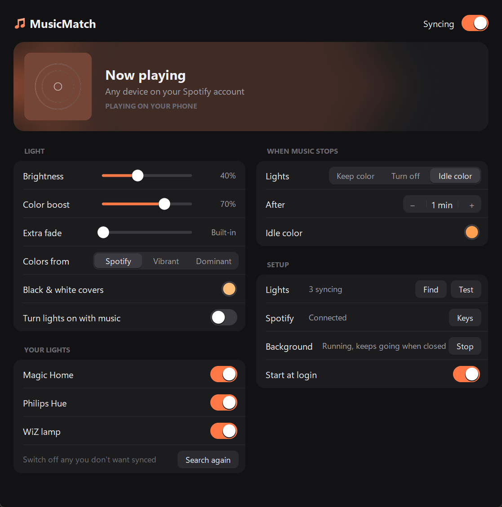

# MusicMatch

Your smart lights change to the color of whatever's playing on Spotify, on **any** device: your phone, a PlayStation, an Echo, a laptop, a TV, or the web player.



- **Finds your lights by itself.** Works with Magic Home, WiZ, LIFX, Govee, Yeelight, and Philips Hue, all at once, straight over your Wi-Fi (no cloud accounts).
- **Matches Spotify's own colors.** It uses the same color Spotify paints behind the album, and changes the moment the next song starts.
- **Stays out of the way.** Close the window and it keeps going from the tray / menu bar, and it can start when you log in.

## Download

**Right now, use the source zip.** There is no prebuilt Windows/Mac app on the Releases page yet, so those old links 404.

| | |
|---|---|
| **Source (Windows or Mac)** | [Download ZIP](https://github.com/Ibrahim-Al-Omran/MusicMatch/archive/refs/heads/main.zip), unzip, then run `Start MusicMatch.cmd` (Windows) or `Start MusicMatch.command` (Mac). Needs [Python 3.10+](https://www.python.org/downloads/). |
| **Windows / Mac apps** | After the first [release](https://github.com/Ibrahim-Al-Omran/MusicMatch/releases) is published, grab `MusicMatch-Windows.zip` or `MusicMatch-macOS.zip` from there. Unzip and open `MusicMatch.exe` or `MusicMatch.app`. |

The packaged apps aren't code-signed, so the first launch needs one extra click:

- **Windows:** if SmartScreen says "Windows protected your PC", click **More info → Run anyway**. Allow it on **private networks** if the firewall asks (that's how it finds your lights).
- **Mac:** open it once, then go to **System Settings → Privacy & Security** and click **Open Anyway**. When asked, allow it to **find devices on your local network**.

More detail: [Run from source](#run-from-source).

## Set up (about 3 minutes)

The computer running MusicMatch needs to be on the **same Wi-Fi as your lights**. It doesn't have to be the one playing music.

### 1. Lights: found automatically

On first launch MusicMatch searches your network and lists every light it finds under **Your lights**. Switch off any you don't want synced. Click **Search again** after adding new lights.

| Brand | One-time step |
|---|---|
| **Magic Home** (and Zengge / flux_led controllers) | None |
| **WiZ** (Philips WiZ and brands built on it) | None |
| **LIFX** | None |
| **Philips Hue** | When MusicMatch says so, press the round button on your Hue bridge |
| **Govee** | In the Govee Home app: device → settings → turn on **LAN Control** |
| **Yeelight** | In the Yeelight app: device → settings → turn on **LAN Control** |

Lights that can only be controlled through Alexa or a cloud app (most Tuya / Smart Life bulbs, for example) can't be driven locally, so they aren't supported.

### 2. Spotify: create your own free key

Spotify only shares "what's playing on this account, on any device" with apps that have a developer key, and it no longer allows one shared key for everyone (each key works for 5 people at most). So each household makes its own. It's free and takes 2 minutes:

1. In MusicMatch, click **Keys** (under Setup), then **Create an app on Spotify**. Log in with the Spotify account you play music on. *Spotify requires the account that creates the app to have Premium.*
2. Click **Create app**. Name and description can be anything. Paste the **Redirect URI** that MusicMatch shows (use **Copy**): `http://127.0.0.1:8888/callback`. Tick **Web API**, agree, and save.
3. Copy the **Client ID** and **Client secret** from the app's page into MusicMatch, and click **Connect**. Your browser asks you to agree once; that's it.

Other people in your home who use a different Spotify account: in the Spotify dashboard, open your app → **User Management** and add their name and email (up to 5).

### 3. Play something

Play anything on Spotify on any device. The lights follow within about a second of each song change.

## Using it

- **Tray / menu-bar icon** (a music note in your light's color): **Open MusicMatch**, **Pause syncing**, **Quit**. On Windows it may hide behind the **^** arrow next to the clock; drag it out to keep it visible.
- **Start at login** (under Setup) keeps it running whenever you're logged in.
- **Brightness** sets how bright the lights get; **Color boost** makes muted covers more vivid without changing brightness.
- **Colors from**: *Spotify* = the color Spotify shows behind the album; *Vibrant* = the most colorful part of the cover; *Dominant* = the most common color, even black or white.
- **When music stops**: keep the last color, turn the lights off, or switch to a color of your choice after a delay.
- **Turn lights on with music** off (the default) means lights you switched off ("Alexa, turn off the lights") stay off.

Settings are saved to `config.json`: next to the code when running from source, otherwise in `%APPDATA%\MusicMatch` (Windows) or `~/Library/Application Support/MusicMatch` (Mac).

## Run from source

Needs Python 3.10+ ([python.org](https://www.python.org/downloads/); on Mac, Homebrew Python also needs `brew install python-tk`).

```bash
git clone https://github.com/Ibrahim-Al-Omran/MusicMatch.git
cd MusicMatch
```

Then double-click **`Start MusicMatch.cmd`** (Windows) or **`Start MusicMatch.command`** (Mac; run `chmod +x "Start MusicMatch.command"` once). The first launch creates a virtual environment and installs everything.

On Windows, once it has run, the **`MusicMatch`** shortcut in the folder has the app icon; right-click it to pin it to Start or the taskbar.

### Command line

Activate the venv (`.\.venv\Scripts\activate`, or `source .venv/bin/activate` on Mac) or, on Windows, use `.\musicmatch` instead of `python -m musicmatch`.

```bash
python -m musicmatch discover --save   # find lights (all brands) and add them to config.json
python -m musicmatch test              # flash red, green, blue
python -m musicmatch auth              # log in to Spotify (once)
python -m musicmatch run               # sync in this terminal (Ctrl+C to stop)
python -m musicmatch brightness 40     # also +10 / -10
python -m musicmatch preview cover.jpg --apply   # see what color a cover gives
```

For an always-on Raspberry Pi: copy the folder (including `.spotify_token_cache` from a machine where you already connected Spotify) and run `python -m musicmatch run` as a systemd service.

## Settings (`config.json`)

| Key | Default | Meaning |
|---|---|---|
| `lights` | | Lights found by the app, e.g. `{"type": "wiz", "host": "192.168.1.20", "name": "Desk", "enabled": true}`. A plain IP string means a Magic Home controller |
| `hue_keys` | | Philips Hue bridges you've paired with (filled in automatically) |
| `color_mode` | `spotify` | `spotify`, `vibrant` or `dominant` (see above) |
| `brightness` | `100` | 1-100 |
| `min_saturation` | `0.55` | 0-1 ("Color boost"). Higher = punchier colors |
| `neutral_color` | warm white | For black-and-white covers and tracks without art |
| `fade_seconds` | `0` | `0` = let each light fade the way it does by itself. Above 0 = a longer fade |
| `poll_interval` | `1.0` | Seconds between Spotify checks (it also checks right as a song ends) |
| `auto_turn_on` | `false` | Turn lights on when music plays, even if you switched them off |
| `idle_after` / `idle_action` / `idle_color` | `60` / `keep` | What happens when music stops: `keep`, `off`, or `color` |

## Troubleshooting

- **No lights found:** the computer must be on the same Wi-Fi as the lights (not a guest network). On Windows, allow MusicMatch (or Python) through the firewall on private networks. Govee and Yeelight need LAN Control switched on in their apps.
- **A light stopped responding:** it probably got a new IP from the router. Click **Search again**; it keeps your on/off choices. Reserving the light's IP in your router (DHCP reservation) prevents this.
- **Spotify says "INVALID_CLIENT: Invalid redirect URI":** the Redirect URI in your Spotify app must be exactly `http://127.0.0.1:8888/callback`.
- **Spotify connects but nothing happens for another person in your home:** add their Spotify email under your app's **User Management**.
- **Only Spotify is supported.** Apple Music, YouTube, or Alexa's own radio stations aren't visible to the Spotify API. Anything played *through Spotify* works, on any device.

## Building the apps

Push a version tag and GitHub Actions builds both apps and attaches them to a release (see `.github/workflows/release.yml`):

```bash
git tag v1.0.0
git push origin v1.0.0
```

To build locally (Windows builds the `.exe`, a Mac builds the `.app`):

```bash
pip install -r requirements.txt -r packaging/requirements-build.txt
pyinstaller packaging/MusicMatch.spec --noconfirm
```

The icons in `assets/` are generated from `musicmatch/logo.py`.

## Tests

```bash
python -m unittest discover -s tests
```
